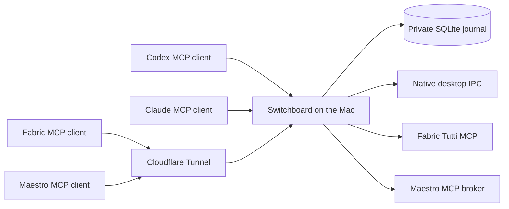

# Architecture

One Mac service owns the provider connections, capability registry, operation
journal, event watches and webhook outbox. Desktop MCP hosts use small stdio
clients that forward to this service. Fabric and Maestro connect through
authenticated HTTPS over a dedicated Cloudflare Tunnel.

The Mac owns desktop IPC and provider credentials, so it is the initial
deployment authority. A Worker cannot access those local sockets. A separate
Rust service would still need a Mac connector and would add another protocol
boundary without removing that dependency. Node supplies the existing adapters,
the maintained MCP SDK and built-in SQLite. Reconsider another implementation
only when measurements identify a limit or a second host requires federation.

Each bearer principal has explicit provider grants and its own operation,
subscription and event views. Provider credentials remain local. Native tools
remain available alongside normalized session and project operations. The
registry exposes exact input schemas, read-only semantics, availability and
limitations; it never invents a missing native lifecycle operation.

## Operations and notifications

Writes enter SQLite before dispatch. A stable caller request ID identifies the
intent and canonical arguments. Identical retries return the same receipt;
changed arguments conflict. A broker crash during dispatch preserves an unknown
outcome and never replays that write automatically.

MCP Tasks describe provider-call completion. They do not claim that an agent
finished its turn. Resource subscriptions invalidate durable journal views.
MCP Events deliver signed webhooks to compatible receivers. Human elicitation
relays native requests through their original continuation and authority.

Exact-session watches adapt native events into bounded metadata. Desktop
sources observe transcript appends; Maestro supplies its observer journal;
Fabric's event-wait tool uses its native thread stream when deployed. Watches
have finite lifetimes, durable source cursors and explicit gap events.
Follow-ups send a bounded number of peer notifications and retain the native
delivery receipt. See [event subscriptions](events.md) for the catalog and
the watch-before-start sequence.

## Codex desktop

The adapter reads recent session metadata from `state_5.sqlite` under
`CODEX_HOME`, which defaults to `~/.codex`. It connects to `ipc/ipc.sock` in that
directory and verifies that the socket is private and owned by the local user.
Saved records establish candidates, not liveness: the application must identify
a running owner for each listed session.

Frames contain a 4-byte little-endian payload length followed by UTF-8 JSON.
Switchboard initializes with its own `agent-switchboard` client type and receives
a client ID. It does not reuse another client's identity.

The following table records the application requests used by the adapter:

| Request | Version | Purpose |
| --- | --- | --- |
| `initialize` | 0 | Registers the local client |
| `thread-owner-discovery` | 1 | Finds a conversation's live owner |
| `thread-follower-start-turn` | 2 | Submits a turn to an existing idle conversation |
| `thread-follower-steer-turn` | 1 | Sends a message to an active turn |
| `thread-follower-interrupt-turn` | 4 | Interrupts the exact guarded active turn |

The adapter reads recent `userMessage` and `agentMessage` items and the latest
recorded turn status from `thread_history_1.sqlite` through a read-only SQLite
connection. This projection can lag live generation. The active-turn check
before `start` is therefore advisory; the owner's response is authoritative.

These interfaces and database names are implementation details of the inspected
application, not a public compatibility contract. The adapter does not use the
separate, code-signing-restricted application-tools pipe or weaken its checks.

## Claude Code

The adapter discovers numeric process records under
`CLAUDE_CONFIG_DIR/sessions`, with `~/.claude` as the default configuration
directory. It verifies each process ID against the recorded start time, using
UTC for the `ps` comparison to avoid time-zone mismatches and stale PID reuse.

For sends, it checks socket ownership and permissions and uses `lsof` to confirm
that the registered process owns the socket. If the process has published a
peer key, the adapter reads it from a private file and sends an authentication
frame before the message. It does not return the key through MCP.

The inbox protocol uses newline-delimited JSON. Each message identifies the
exact destination session and has a fresh message ID. A short-lived reply
socket collects policy receipts correlated by message ID and sender address.
It closes after the bounded receipt window, so delayed receipts and idle
notifications are not retained.

When the host supplies a Codex task ID through executor metadata or
`CODEX_THREAD_ID`, the adapter reads that task's stored approval and sandbox
settings to describe its sender context. Missing or unrecognized context stays
unknown. There is no caller-selected permission mode, and the adapter never
copies the destination's mode or approves a held message. These are same-user
metadata checks, not protection against a malicious local process that can
alter the same files or environment.

Transcript reads resolve the live session's working directory and UUID to a
project transcript. They include user and assistant text, omit tool results and
reasoning blocks, and report truncation. Alternate transcript layouts need a
separate adapter.

## Trust and failure handling

The broker durably records dispatch receipts and caller-scoped events. Client
tool approvals and destination permissions remain authoritative. A transport
acknowledgment, queue receipt and completed agent response are different
outcomes. A signed webhook acknowledgment establishes receiver receipt;
an actual client journey must establish model wakeup separately.

The socket checks reduce stale-target risk but do not verify the connected
peer's process ID at the kernel level. Receipt correlation is not authenticated
peer identity. The implementation is not hardened against a hostile process
running under the same local account or endpoint replacement between a check
and connection.

Do not edit live conversation databases, rewrite transcripts, change inbound
message policy, or disable permission checks to force delivery. After uncertain
delivery, inspect the receiving conversation before resubmitting.
